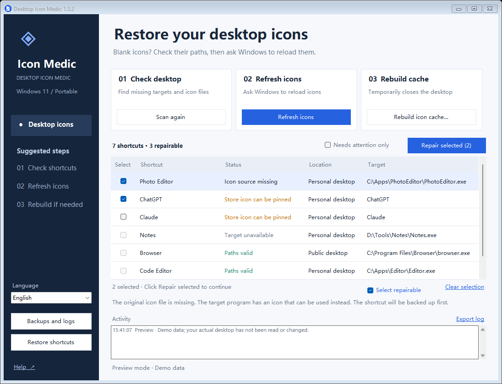

# DesktopIconMedic

**English** | [简体中文](README.zh-CN.md) | [繁體中文](README.zh-TW.md)

A portable Windows 11 utility for fixing blank desktop shortcut icons. It supports English, Simplified Chinese and Traditional Chinese, with backup and restore. No installation, network access, startup entry or registry changes.

**Free and open-source under [GPL-3.0-only](LICENSE).** Commercial use, modification and paid redistribution are permitted under the GPL's terms.

[Official repository](https://github.com/Sulock/DesktopIconMedic) · [Downloads](https://github.com/Sulock/DesktopIconMedic/releases/latest) · [Report an issue](https://github.com/Sulock/DesktopIconMedic/issues)



## Download and run

1. Open [Releases](https://github.com/Sulock/DesktopIconMedic/releases/latest) and download the `DesktopIconMedic-vVERSION-portable.zip` attachment.
2. Extract the ZIP and run `DesktopIconMedic.exe`. Keep `DesktopIconMedic.exe.config` beside it, and close any older running version first.

To build the app yourself, follow the instructions below. GitHub's **Code → Download ZIP** contains source code, which must be built before use.

Windows 11 includes the required .NET Framework 4.8. No Python or other development environment is needed to run the app. The executable is currently unsigned, so Windows may show an unknown-publisher prompt when checking a download or launch.

At startup, the app scans desktop shortcuts. Repairs and cache rebuilding require a separate action. Ordinary operations do not require administrator permission.

## Choose a language

Use the **Language** dropdown at the bottom of the sidebar to select **English**, **简体中文** or **繁體中文**. The interface changes immediately and keeps the current filter, checked shortcuts and focused row.

On first launch, the app follows the Windows display language: Simplified Chinese for Simplified Chinese systems, Traditional Chinese for Traditional Chinese systems, and English for other languages. Your manual choice is saved in `%LOCALAPPDATA%\DesktopIconMedic\settings.json` and restored on the next launch.

Existing log entries keep the language used when they were recorded. New entries use the selected language. Windows file dialogs, standard message buttons and operating-system error messages may use the Windows language.

## Suggested repair order

1. **Check desktop:** scan `.lnk` and `.url` files on your personal and public desktops.
2. **Refresh icons:** if the paths look valid but an icon is blank, request a refresh and wait a moment.
3. **Repair icon sources:** select shortcuts marked **Icon source missing**, then click **Repair selected**. The app backs up each shortcut and uses the target executable's embedded icon.
4. **Rebuild the icon cache:** if refreshing does not help, confirm the cache-rebuild prompt. The app temporarily closes Windows Explorer in the current session, backs up and removes icon caches, then restores the desktop so Windows can rebuild them.
5. **Pin a Store app icon:** Store apps such as ChatGPT and Claude may not have an ordinary executable target. If a shortcut is marked **Store icon can be pinned** and its icon looks wrong, select it and click **Repair selected**. The app extracts the installed app's icon into a stable local file while preserving its launch identity. This action does not restart the desktop.

Cache rebuilding briefly hides the desktop and taskbar and may close folder windows. Finish file copies or moves and save your work first. The app does not restart Windows automatically. Cache files that remain locked are kept and reported in the log.

If the desktop does not return automatically, press **Ctrl + Shift + Esc**, choose **Run new task** in Task Manager, and enter `explorer.exe`.

## Understand scan results

Check multiple rows to repair them together. **Select repairable** selects only supported shortcuts in the current list; **Clear selection** clears them. Gray checkboxes indicate unsupported items. Select a row to see why, or double-click it for full paths. Rescanning or changing the filter clears the selection; changing the interface language preserves it.

| Status | Meaning and suggested action |
| --- | --- |
| Paths valid | No missing target or icon file was found. Cache, resource-index or file-content problems may still affect the icon; try refreshing it. |
| Icon source missing | The icon file is missing and the target executable has an icon available for repair. |
| Store icon can be pinned | An installed Store app icon is available. Select the shortcut if its displayed icon looks wrong; this status alone does not mean it is broken. |
| Target unavailable | The app may have moved or been uninstalled, or its drive or cloud file may be unavailable. Check the installation and recreate the shortcut. |
| Special shortcut | A system, installer-managed, web, game, relative-icon-path or unsupported Store link. These are not rewritten automatically. |
| Network path skipped | The shortcut, target or icon is on a network share or network drive and was not accessed. |
| Cannot read | The file may be corrupt, inaccessible, a reparse point or a cloud placeholder. Open its details for the reported reason. |

The scan checks file paths, not the appearance of icons on screen. Virtual desktop items such as Recycle Bin and This PC are not listed as shortcuts; icon refresh and cache rebuilding can still be tried.

Modifying public desktop shortcuts may require **Run as administrator**. Use the same Windows account: running as another user scans that user's desktop and cache.

## Backups and local data

All application data stays on your computer:

```text
%LOCALAPPDATA%\DesktopIconMedic\
  settings.json                  Saved interface language
  Backups\shortcuts_TIME_ID\     Original shortcuts and verification manifest
  Backups\cache_TIME_ID\         Removed cache files and original paths
  Logs\DATE.log                  Activity logs
  Icons\APP_ID_CONTENT_HASH.ico  Pinned Store app icons
```

- Use **Restore shortcuts** to choose a repair session and restore the original shortcut files.
- Backups are checked with SHA-256. Restore skips altered backups and shortcuts changed or deleted after repair.
- If writing or verifying a shortcut fails, the app attempts to roll it back. If permissions prevent rollback, the original remains in the backup folder and the log records the failure.
- Cache backups are for manual troubleshooting and are not restored automatically.
- **Keep the `Icons` folder.** Pinned Store shortcuts refer to these files. Moving or updating this utility does not affect them, but deleting that folder breaks the icon references. Pinned icons do not automatically change when an app changes its branding.
- Backups are not deleted automatically. Use **Backups and logs** to review them.
- Logs may contain local file paths. Remove personal information before sharing them.

## Repair scope

Cache operations are restricted to the current account's `%LOCALAPPDATA%\IconCache.db` and matching `iconcache*.db` files directly inside `%LOCALAPPDATA%\Microsoft\Windows\Explorer`. Thumbnail caches, desktop files and nested directories are not cleaned.

Ordinary shortcut repair updates a confirmed missing icon source. Store shortcuts can use a pinned copy of their installed icon. Repairs verify that launch targets, arguments, working directories, descriptions and original Shell launch identities remain unchanged.

The app does not guess where missing programs moved or rewrite network paths, web links, Windows Installer shortcuts or special links without a confirmed icon source. Repeated failures may come from cleanup utilities deleting caches, app updates changing paths or desktop-sync software restoring old shortcuts.

## Build and test

Source files are in `src`. The build uses the Windows .NET Framework C# compiler and downloads no dependencies. From the repository root, run this in Windows PowerShell:

```powershell
powershell.exe -NoProfile -ExecutionPolicy Bypass -File .\build.ps1 -OutputDirectory release-v1.3.2 -Test
```

The build copies the three READMEs, screenshots and GPL license beside the executable. Use `-Package` to create the portable ZIP, a matching source ZIP and SHA-256 checksums. The portable ZIP also includes the source ZIP:

```powershell
powershell.exe -NoProfile -ExecutionPolicy Bypass -File .\build.ps1 -OutputDirectory release-v1.3.2 -Test -Package
```

Version 1.3.2 has **33 automated tests**, covering repair and byte-identical restore, preserved launch information, changes after scanning, restore conflicts, altered backups, read-only files, special links, cache boundaries, recovery failures, language selection and persistence, and translated UI state.

Tests use temporary shortcuts and simulated caches under `test-results`. They do not modify actual desktop shortcuts, delete actual icon caches or restart Windows Explorer. The real Explorer stop/restart sequence has not been validated by these tests. Store icon extraction, preserved launch identities and byte-identical restore were previously checked with local copies of ChatGPT and Claude shortcuts.

To render the visible demo windows and save screenshots in all three languages:

```powershell
.\release-v1.3.2\Tests.exe .\test-results --visible-preview
```

## License

Copyright (c) 2026 Sulock. DesktopIconMedic's source code, documentation and original project assets are licensed under the **GNU General Public License, version 3 only** (`GPL-3.0-only`). The complete, unmodified license is in [LICENSE](LICENSE).

You may use, modify and redistribute this software, including commercially and for a fee, under the terms of GPL version 3. When distributing the program or a covered derivative work, preserve the required notices, provide the corresponding source in accordance with the GPL, and preserve recipients' GPL rights.

This program is distributed in the hope that it will be useful, but **without any warranty**, including the implied warranties of merchantability or fitness for a particular purpose. See the GNU General Public License for details.

The portable package includes `DesktopIconMedic-vVERSION-source.zip`, containing the matching source, tests, assets, documentation and build script. Extract that source archive and follow the build instructions above to rebuild the program.

Third-party application icons and trademarks remain the property of their respective rights holders. Windows and .NET Framework components remain subject to their own terms.

## Report a problem

Open an [issue](https://github.com/Sulock/DesktopIconMedic/issues) with your Windows version, app version, steps to reproduce, scan results and relevant logs. Remove usernames, private paths and other personal information from logs and screenshots before posting.

Version: **1.3.2**.
