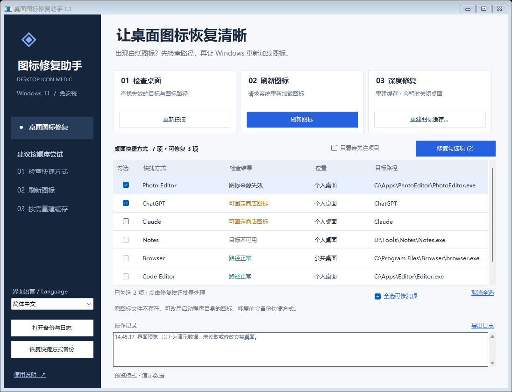

# DesktopIconMedic · 桌面图标修复助手

[English](README.md) | **简体中文** | [繁體中文](README.zh-TW.md)

一个为 Windows 11 制作的桌面工具，支持简体中文、繁体中文和英文，用于处理桌面快捷方式变成白纸图标的问题。免安装，无联网功能，不添加开机启动，不修改注册表。

**免费使用，源码公开。未经作者书面授权，禁止收费分发原版、修改版或将其捆绑到付费产品中分发。** 个人和企业内部使用均免费，具体权限见 [LICENSE](LICENSE)。

官方项目：[Sulock/DesktopIconMedic](https://github.com/Sulock/DesktopIconMedic) · [版本下载](https://github.com/Sulock/DesktopIconMedic/releases) · [问题反馈](https://github.com/Sulock/DesktopIconMedic/issues)



## 下载与运行

进入 [Releases](https://github.com/Sulock/DesktopIconMedic/releases)，下载版本附件中的 `DesktopIconMedic-v版本号-portable.zip`，解压后双击 `DesktopIconMedic.exe`。先关闭旧版窗口，并将 EXE 与同目录的 `DesktopIconMedic.exe.config` 放在一起。若尚无已发布的便携版，可按下方“构建与测试”从源码生成程序。

Windows 11 已包含所需的 .NET Framework 4.8；不需要安装 Python 或其他开发环境。GitHub 的“Code → Download ZIP”下载的是源码，需要自行构建。当前程序未做数字签名，Windows 下载或启动检查可能显示发布者未知的提示。

软件启动后只检查桌面快捷方式，不会自动修改快捷方式、清理缓存或重启桌面。普通操作无需管理员权限。

## 切换语言

在窗口左下方的“界面语言 / Language”下拉框中选择 **简体中文**、**繁體中文** 或 **English**，界面会立即切换，并保留当前筛选、勾选项目和已选中的行。

首次启动时跟随 Windows 的界面语言：简体中文系统使用简体中文，繁体中文系统使用繁体中文，其他系统使用英文。手动选择会保存到 `%LOCALAPPDATA%\DesktopIconMedic\settings.json`，下次启动继续使用所选语言。

已有日志保留记录时的语言；后续日志使用新选择的语言。Windows 提供的文件对话框、标准消息按钮及系统错误说明可能使用系统语言。

## 建议使用顺序

1. **检查桌面**：启动时自动扫描个人桌面和公共桌面的 `.lnk` / `.url` 文件。
2. **刷新图标**：如果目标路径正常但仍显示白纸，先点击“刷新图标”，等待片刻并观察桌面。
3. **修复图标来源**：若列表显示“图标来源失效”，勾选项目后点击“修复勾选项”。工具会先备份，再将图标来源改为目标 EXE 的内置图标。
4. **重建图标缓存**：刷新无效时使用。确认提示后，工具会暂时关闭当前会话的资源管理器，备份并移除图标缓存，随后恢复桌面，由 Windows 重新生成缓存。
5. **商店应用仍显示白纸**：ChatGPT、Claude 等商店应用可能没有普通 EXE 目标路径。1.1 版会将有可用原图标的项目标记为“可固定商店图标”。仅勾选实际显示异常的项目并点击“修复勾选项”，工具会从当前安装包提取原图标，保存为稳定的本地图标文件，保留原应用启动标识。此步骤不需要重启桌面。

重建缓存时，桌面和任务栏会短暂消失，文件夹窗口可能关闭。操作前请结束文件复制 / 移动并保存正在编辑的内容。工具不会自动重启电脑。部分缓存被占用时会保留并记录原因；必要时可手动重启电脑后再试。

若自动恢复桌面失败，按 **Ctrl + Shift + Esc** 打开任务管理器，选择“运行新任务”，输入 `explorer.exe`。

## 检查结果的含义

1.2 版在每行前显示勾选方框。可以同时勾选多个可修复项目，按钮会显示数量，例如“修复勾选项 (3)”，点击后批量备份和修复。也可以使用“全选可修复项”或“取消全选”。全选仅作用于当前列表中支持自动修复的项目；灰色方框表示暂不支持自动修复，选中该行可查看原因。重新扫描或切换筛选条件会清空勾选，请确认后重新选择。

| 结果 | 含义与建议 |
| --- | --- |
| 路径正常 | 没有发现缺失的目标或图标文件。仍可能存在缓存、图标资源索引或文件内容问题，可先刷新。 |
| 图标来源失效 | 图标文件缺失，且目标程序含有可用图标。可勾选修复。 |
| 可固定商店图标 | 已确认商店应用的本地图标来源。如仍显示白纸，可勾选修复；该状态本身不代表图标已损坏。 |
| 目标不可用 | 软件可能被移动、卸载，或磁盘 / 云文件当前不可用。请检查安装情况并重新创建快捷方式。 |
| 特殊快捷方式 | 系统、无法读取图标的商店应用、安装器管理、网页、游戏启动链接或相对图标路径等，不自动改写。 |
| 需联网检查 | 路径位于网络共享或网络驱动器，本工具跳过检查。 |
| 无法读取 | 文件损坏、权限不足，或含重解析点 / 云同步占位符等。双击查看原因。 |

“检查桌面”检查的是文件路径，不能自动识别屏幕上哪些图标显示成白纸，也不能保证修复所有原因。桌面的回收站、此电脑等虚拟图标不在快捷方式列表中，但可尝试图标刷新和缓存重建。

公共桌面的快捷方式可能需要管理员权限才可修改；如明确需要修复公共桌面，可右键本程序选择“以管理员身份运行”。不要使用另一位用户的账户运行，否则会检查那位用户的桌面与缓存。

## 备份与恢复

数据仅保存在本机：

```text
%LOCALAPPDATA%\DesktopIconMedic\
  Backups\shortcuts_时间_编号\   原快捷方式和校验清单
  Backups\cache_时间_编号\       已移除缓存的备份和原路径记录
  settings.json                 界面语言选择
  Logs\日期.log                  操作日志
  Icons\应用标识_内容校验值.ico   商店应用修复后的图标文件
```

- 点击“恢复快捷方式备份”，选择一次修复记录，可以恢复原快捷方式。
- 备份采用 SHA-256 校验。如果备份被改动，或当前快捷方式在修复后又被修改 / 删除，工具会跳过恢复，避免覆盖用户的新更改。
- 单个快捷方式写入或验证失败时会尝试回退；如果权限阻止回退，原文件仍保存在备份目录，日志会说明。
- 缓存备份仅供人工排查，不会自动恢复，以免重新引入损坏的缓存。
- **请保留 Icons 文件夹**：商店应用修复后的快捷方式会引用这里的图标。更新或移动本工具的 EXE 不影响这些图标；删除 Icons 文件夹会使图标再次失效。应用改换品牌图标后，本地固定图标不会自动更新。
- 备份不会自动删除。无需保留时可通过“打开备份与日志”自行整理。
- 日志可能包含本机文件路径。分享给他人前请检查其中的个人信息。

## 修复范围

缓存操作只允许当前账户的 `%LOCALAPPDATA%\IconCache.db` 以及 `%LOCALAPPDATA%\Microsoft\Windows\Explorer\iconcache*.db` 中匹配的图标数据库。不处理缩略图缓存，不递归清理文件夹，不删除桌面文件。

普通快捷方式修复只更新明确失效的图标来源；商店应用可选择固定已安装的原图标。修复会校验启动目标、启动参数、工作目录、描述及原始 Shell 启动标识是否保持不变。不会猜测丢失的程序位置，不改写网络路径、无法确认图标来源的特殊链接、网页链接或 Windows Installer 管理的快捷方式。

如果经常复发，可检查清理工具是否删除缓存、软件更新是否改变图标路径，以及桌面同步软件是否重新覆盖快捷方式。此工具负责修复症状与部分路径问题，不会阻止外部软件再次修改文件。

## 构建与测试

源代码位于 `src`，使用 Windows 自带的 .NET Framework C# 编译器，无需下载依赖。

```powershell
powershell.exe -NoProfile -ExecutionPolicy Bypass -File .\build.ps1 -OutputDirectory release-v1.3 -Test
```

构建会将三份 README、截图、许可证及英文译文复制到输出目录。若还需生成便携版 ZIP 和 SHA-256 校验文件，执行：

```powershell
powershell.exe -NoProfile -ExecutionPolicy Bypass -File .\build.ps1 -OutputDirectory release-v1.3 -Test -Package
```

测试使用项目目录内的临时快捷方式和模拟缓存，不会修改真实桌面、清理真实缓存或重启资源管理器。测试覆盖修复与原样恢复、启动信息保留、扫描后变更保护、恢复冲突、备份校验、只读文件、特殊链接、缓存范围及异常后的恢复流程。

若需核验可见窗口：

```powershell
.\release-v1.3\Tests.exe .\test-results --visible-preview
```

窗口仅显示演示数据，截图写入 `test-results`。深度修复的真实资源管理器终止与重启未在开发期间执行；自动化测试使用替代会话验证相应的处理顺序与失败路径。

1.1 版通过 23 项自动化测试，并使用本机 ChatGPT 和 Claude 快捷方式的副本验证：图标提取、修复、启动标识保留、Windows 图标读取，以及备份的逐字节恢复。

1.2 版新增多项勾选、全选/取消全选和批量修复恢复验证，共 25 项自动化测试。

1.3 版新增三种语言切换、语言选择保存、系统语言识别和多语言界面测试，共 32 项自动化测试。

## 许可与免费分发

Copyright (c) 2026 Sulock。本项目使用自定义的[免费使用与禁止收费分发许可协议](LICENSE)，以源码公开（source-available）方式发布。

- 允许免费使用、学习和修改，也允许个人及企业内部使用。
- 免费分享原版或修改版时，须附带完整 LICENSE，保留版权声明和官方项目地址；修改版须说明修改者。
- 未经作者书面授权，禁止销售原版或修改版、设置付费下载或会员门槛，以及捆绑到付费产品中分发。

完整授权条件以中文 LICENSE 为准，同时提供 [English translation](LICENSE.en.md)。需要其他授权时，请通过[官方项目页面](https://github.com/Sulock/DesktopIconMedic)联系作者。

## 问题反馈

请在 [Issues](https://github.com/Sulock/DesktopIconMedic/issues) 提供 Windows 版本、软件版本、操作步骤、检查结果和相关日志。提交日志或截图前，请隐藏用户名、私人目录及其他个人信息。

版本：1.3.0。
