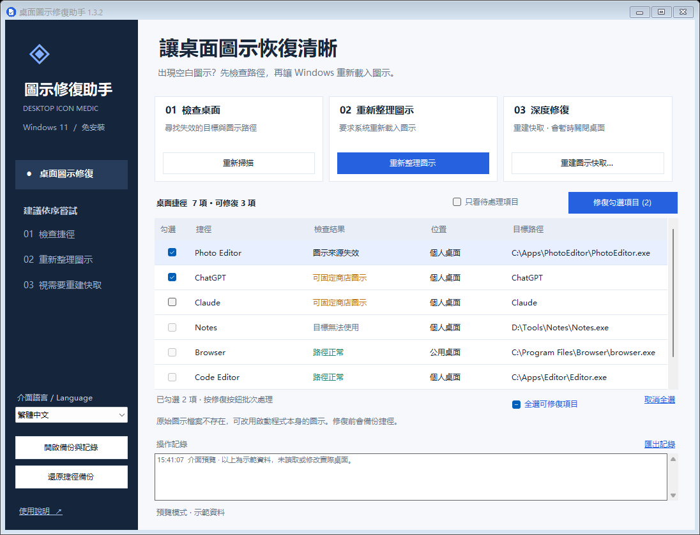

# DesktopIconMedic · 桌面圖示修復助手

[English](README.md) | [简体中文](README.zh-CN.md) | **繁體中文**

一個為 Windows 11 製作的桌面工具，支援簡體中文、繁體中文和英文，用於處理桌面捷徑變成白紙圖示的問題。免安裝，無聯網功能，不添加開機自動啟動，不修改登錄檔。

**本專案採用 [GPL-3.0-only](LICENSE) 開放原始碼授權條款。** 允許依 GPL 條款商業使用、修改及收費再散布。

官方專案：[Sulock/DesktopIconMedic](https://github.com/Sulock/DesktopIconMedic) · [版本下載](https://github.com/Sulock/DesktopIconMedic/releases) · [問題回報](https://github.com/Sulock/DesktopIconMedic/issues)



## 下載與執行

進入 [Releases](https://github.com/Sulock/DesktopIconMedic/releases)，下載版本附件中的 `DesktopIconMedic-v版本號-portable.zip`，解壓縮後按兩下 `DesktopIconMedic.exe`。先關閉舊版視窗，並將 EXE 與同目錄的 `DesktopIconMedic.exe.config` 放在一起。若尚無已發佈的可攜版，可按下方「建置與測試」從原始碼產生程式。

Windows 11 已包含所需的 .NET Framework 4.8；不需要安裝 Python 或其他開發環境。GitHub 的「Code → Download ZIP」下載的是原始碼，需要自行建置。目前程式未做數位簽章，Windows 下載或啟動檢查可能顯示發行者未知的提示。

軟體啟動後只檢查桌面捷徑，不會自動修改捷徑、清理快取或重新啟動桌面。一般操作無需系統管理員權限。

## 切換語言

在視窗左下方的「介面語言 / Language」下拉選單中選擇 **简体中文**、**繁體中文** 或 **English**，介面會立即切換，並保留目前篩選條件、勾選項目及選取的資料列。

首次啟動時跟隨 Windows 的介面語言：簡體中文系統使用簡體中文，繁體中文系統使用繁體中文，其他系統使用英文。手動選擇會儲存到 `%LOCALAPPDATA%\DesktopIconMedic\settings.json`，下次啟動繼續使用所選語言。

已有記錄保留記錄時的語言；後續記錄使用新選擇的語言。Windows 提供的檔案對話框、標準訊息按鈕及系統錯誤說明可能使用系統語言。

## 建議使用順序

1. **檢查桌面**：啟動時自動掃描個人桌面和公用桌面的 `.lnk` / `.url` 檔案。
2. **重新整理圖示**：如果目標路徑正常但仍顯示白紙，先按一下「重新整理圖示」，等待片刻並觀察桌面。
3. **修復圖示來源**：若清單顯示「圖示來源失效」，勾選項目後按一下「修復勾選項目」。工具會先備份，再將圖示來源改為目標 EXE 的內建圖示。
4. **重建圖示快取**：重新整理無效時使用。確認提示後，工具會暫時關閉目前工作階段的檔案總管，備份並移除圖示快取，隨後恢復桌面，由 Windows 重新產生快取。
5. **商店應用程式仍顯示白紙**：ChatGPT、Claude 等商店應用程式可能沒有一般 EXE 目標路徑。1.1 版會將有可用原圖示的項目標記為「可固定商店圖示」。僅勾選實際顯示異常的項目並按一下「修復勾選項目」，工具會從目前安裝套件擷取原圖示，儲存為穩定的本機圖示檔案，保留原應用程式啟動識別碼。此步驟不需要重新啟動桌面。

重建快取時，桌面和工作列會短暫消失，資料夾視窗可能關閉。操作前請結束檔案複製 / 移動並儲存正在編輯的內容。工具不會自動重新啟動電腦。部分快取被使用時會保留並記錄原因；必要時可手動重新啟動電腦後再試。

若自動恢復桌面失敗，按 **Ctrl + Shift + Esc** 打開工作管理員，選擇「執行新工作」，輸入 `explorer.exe`。

## 檢查結果的含義

1.2 版在每行前顯示勾選方框。可以同時勾選多個可修復項目，按鈕會顯示數量，例如「修復勾選項目 (3)」，按一下後批次備份和修復。也可以使用「全選可修復項目」或「取消全選」。全選僅作用於目前清單中支援自動修復的項目；灰色方框表示暫不支援自動修復，選中該行可查看原因。重新掃描或切換篩選條件會清空勾選，請確認後重新選擇。

| 結果 | 含義與建議 |
| --- | --- |
| 路徑正常 | 沒有發現遺失的目標或圖示檔案。仍可能存在快取、圖示資源索引或檔案內容問題，可先重新整理。 |
| 圖示來源失效 | 圖示檔案遺失，且目標程式含有可用圖示。可勾選修復。 |
| 可固定商店圖示 | 已確認商店應用程式的本機圖示來源。如仍顯示白紙，可勾選修復；該狀態本身不代表圖示已損壞。 |
| 目標無法使用 | 軟體可能被移動、解除安裝，或磁碟 / 雲端檔案目前不可用。請檢查安裝情況並重新建立捷徑。 |
| 特殊捷徑 | 系統、無法讀取圖示的商店應用程式、安裝器管理、網頁、遊戲啟動連結或相對圖示路徑等，不自動改寫。 |
| 需連線檢查 | 路徑位於網路共用或網路磁碟機，本工具跳過檢查。 |
| 無法讀取 | 檔案損壞、權限不足，或含重新解析點 / 雲端同步預留位置等。按兩下查看原因。 |

「檢查桌面」檢查的是檔案路徑，不能自動識別螢幕上哪些圖示顯示成白紙，也不能保證修復所有原因。桌面的資源回收筒、此電腦等虛擬圖示不在捷徑清單中，但可嘗試圖示重新整理和快取重建。

公用桌面的捷徑可能需要系統管理員權限才可修改；如明確需要修復公用桌面，可以滑鼠右鍵按一下本程式選擇「以系統管理員身分執行」。不要使用另一位使用者的帳戶執行，否則會檢查那位使用者的桌面與快取。

## 備份與還原

資料僅儲存在本機：

```text
%LOCALAPPDATA%\DesktopIconMedic\
  Backups\shortcuts_時間_編號\   原始捷徑和驗證清單
  Backups\cache_時間_編號\       已移除快取的備份和原路徑記錄
  settings.json                 介面語言選擇
  Logs\日期.log                  操作記錄
  Icons\應用程式識別碼_內容驗證值.ico   商店應用程式修復後的圖示檔案
```

- 按一下「還原捷徑備份」，選擇一次修復記錄，可以還原原始捷徑。
- 備份採用 SHA-256 驗證。如果備份被改動，或目前捷徑在修復後又被修改 / 刪除，工具會跳過恢復，避免覆蓋使用者的新更改。
- 單個捷徑寫入或驗證失敗時會嘗試復原；如果權限阻止復原，原始檔案仍儲存在備份目錄，記錄會說明。
- 快取備份僅供人工排查，不會自動恢復，以免重新引入損壞的快取。
- **請保留 Icons 資料夾**：商店應用程式修復後的捷徑會引用這裡的圖示。更新或移動本工具的 EXE 不影響這些圖示；刪除 Icons 資料夾會使圖示再次失效。應用程式改換品牌圖示後，本機固定圖示不會自動更新。
- 備份不會自動刪除。無需保留時可透過「開啟備份與記錄」自行整理。
- 記錄可能包含本機檔案路徑。分享給他人前請檢查其中的個人資訊。

## 修復範圍

快取操作只允許目前帳戶的 `%LOCALAPPDATA%\IconCache.db` 以及 `%LOCALAPPDATA%\Microsoft\Windows\Explorer\iconcache*.db` 中匹配的圖示資料庫。不處理縮圖快取，不遞迴清理資料夾，不刪除桌面檔案。

一般捷徑修復只更新明確失效的圖示來源；商店應用程式可選擇固定已安裝的原圖示。修復會驗證啟動目標、啟動參數、工作目錄、描述及原始 Shell 啟動識別碼是否保持不變。不會猜測遺失的程式位置，不改寫網路路徑、無法確認圖示來源的特殊連結、網頁連結或 Windows Installer 管理的捷徑。

如果經常復發，可檢查清理工具是否刪除快取、軟體更新是否改變圖示路徑，以及桌面同步軟體是否重新覆蓋捷徑。此工具負責修復症狀與部分路徑問題，不會阻止外部軟體再次修改檔案。

## 建置與測試

原始碼位於 `src`，使用 Windows 內建的 .NET Framework C# 編譯器，無需下載相依套件。

```powershell
powershell.exe -NoProfile -ExecutionPolicy Bypass -File .\build.ps1 -OutputDirectory release-v1.3.1 -Test
```

建置時會將三份 README、截圖、GPL 授權條款複製到輸出目錄。加上 `-Package` 會產生可攜版 ZIP、對應原始碼 ZIP 與兩者的 SHA-256 驗證檔案；可攜版內也包含原始碼 ZIP：

```powershell
powershell.exe -NoProfile -ExecutionPolicy Bypass -File .\build.ps1 -OutputDirectory release-v1.3.1 -Test -Package
```

測試使用專案目錄內的暫存捷徑和模擬快取，不會修改實際桌面、清理實際快取或重新啟動檔案總管。測試覆蓋修復與原樣恢復、啟動資訊保留、掃描後變更保護、恢復衝突、備份驗證、唯讀檔案、特殊連結、快取範圍及異常後的恢復流程。

若需核驗可見視窗：

```powershell
.\release-v1.3.1\Tests.exe .\test-results --visible-preview
```

視窗僅顯示示範資料，截圖寫入 `test-results`。深度修復的實際檔案總管終止與重新啟動未在開發期間執行；自動化測試使用模擬工作階段驗證相應的處理順序與失敗路徑。

1.1 版通過 23 項自動化測試，並使用本機 ChatGPT 和 Claude 捷徑的副本驗證：圖示擷取、修復、啟動識別碼保留、Windows 圖示讀取，以及備份的逐位元組恢復。

1.2 版新增多項勾選、全選/取消全選和批次修復恢復驗證，共 25 項自動化測試。

1.3 版新增三種語言切換、語言選擇儲存、系統語言識別和多語言介面測試，共 32 項自動化測試。

## 授權條款

Copyright (c) 2026 Sulock。本專案的原始碼、文件與原創資源採用 **GNU 通用公共授權條款第 3 版，僅限此版本**（`GPL-3.0-only`）。未經修改的完整授權條款見 [LICENSE](LICENSE)。

你可以依照 GPL 第 3 版使用、修改及再散布本軟體，包括商業使用與收費散布。散布本程式或受 GPL 約束的衍生作品時，須保留規定的聲明、依 GPL 提供對應原始碼，並保留接收者享有的 GPL 權利。

本軟體希望能對你有所幫助，但**不提供任何擔保**，包括適銷性或特定用途適用性的默示擔保。詳細條款請參閱 GNU 通用公共授權條款。

可攜版套件內附有 `DesktopIconMedic-v版本號-source.zip`，包含該版本對應的原始碼、測試、資源、文件及建置指令碼。解壓縮原始碼套件後，可依上方說明重新建置程式。

第三方應用程式圖示與商標仍屬於各自權利人；Windows 與 .NET Framework 元件繼續適用各自的條款。

## 問題回報

請在 [Issues](https://github.com/Sulock/DesktopIconMedic/issues) 提供 Windows 版本、軟體版本、操作步驟、檢查結果和相關記錄。提交記錄或截圖前，請隱藏使用者名、私人目錄及其他個人資訊。

版本：1.3.1。
